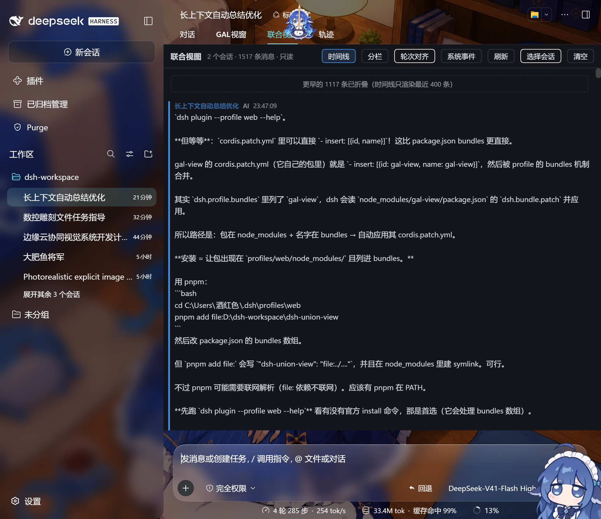
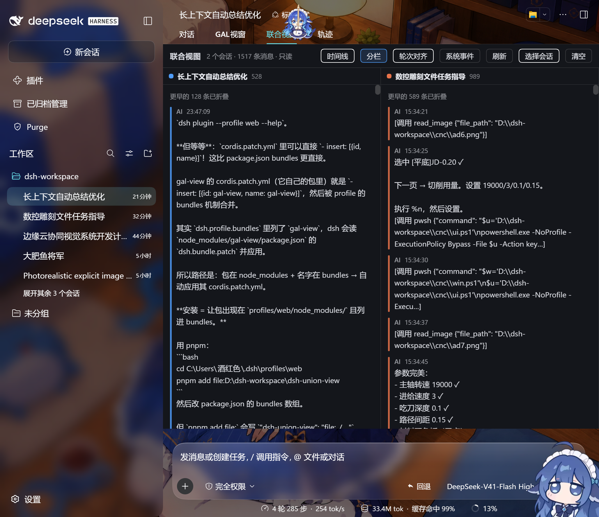
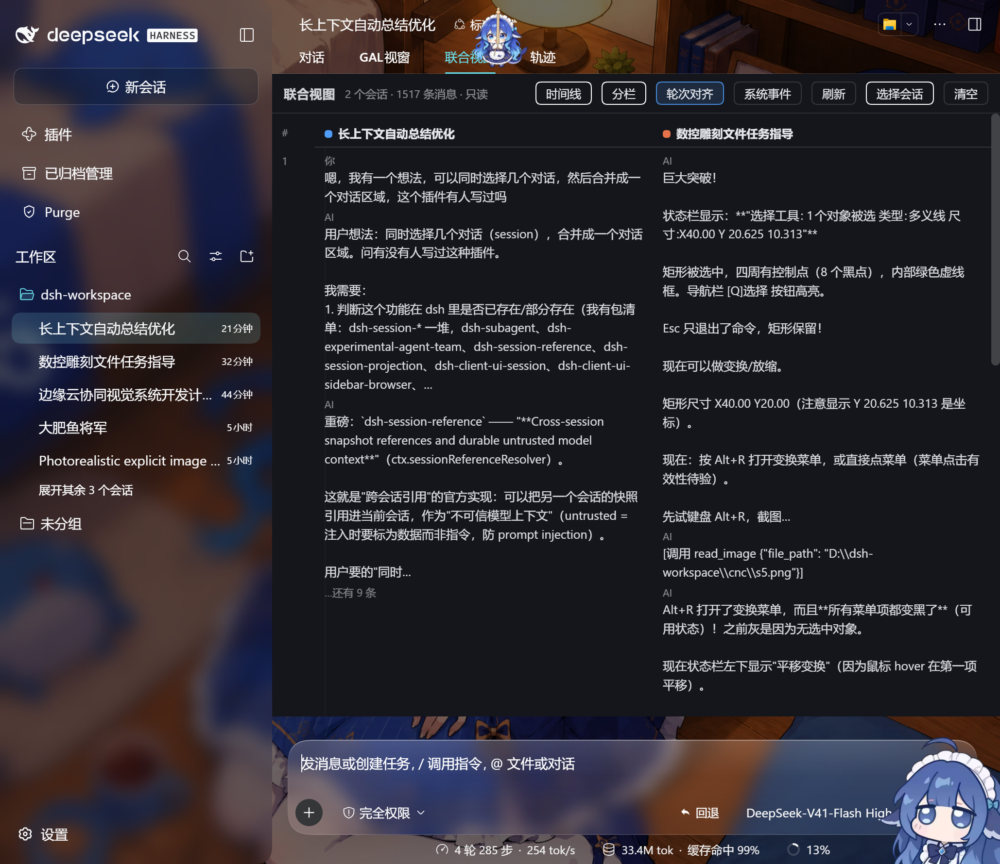

# 联合视图（dsh-union-view）

> 把好几个对话并排摊在屏幕上一起看；需要的话，还能把它们的历史焊成一个新对话接着聊。

## 先说这东西解决什么

假设你最近在干一件事，但聊得很散：

- 上周定需求，在 **A** 对话里
- 中间反复试错，在 **B** 对话里
- 最后结论和踩过的坑，记在 **C** 对话里

现在你想回顾整件事。怎么办？点开 A 翻一遍，退出来，点开 B 翻一遍，退出来，点开 C 翻一遍。翻到 C 的时候，A 里说的什么已经忘了一半。

**联合视图就是为这个做的**：勾上 A、B、C，三份对话同时摊在同一个屏幕上，左右对照着看。

```
┌ 对话   GAL视窗   [联合视图]   轨迹 ┐
│ 联合视图  3 个会话 · 1500 条消息 · 只读                    │
│ ─── 定需求 ───┬─── 试错 ───┬─── 结论 ─── │
│ 你 14:02      │ AI 15:31   │ AI 23:44    │
│ 我想做…       │ 报错了：…  │ 所以最终…   │
└───────────────┴────────────┴─────────────┘
```

## 三种摆法

浏览器里点一下就能换，随时切：

| 摆法 | 什么时候用 |
| --- | --- |
| **时间线** | 想知道"当时到底先发生什么、后发生什么" |
| **分栏** | 想知道"同一时间，两边各自在干嘛" |
| **轮次对齐** | 想知道"同一个问题，两边分别怎么回答的" |





## 最重要的一件事：它只是"看"

用联合视图的时候，它**只读不写**：

- 原对话里一个字都不会被改
- 不会把几份对话合并、搬来搬去
- **AI 完全不知道你在这么看** —— 就像你把三份打印稿摊在桌上比对，桌上那台电脑（AI）并不知道

所以它很安全，随便试：看完关掉，世界和之前一模一样。

消息太多时它也不会卡死——每个视角只摆最近一段，上面会提示"更早的 N 条已折叠"。

## 如果你想让 AI 真的看见：`/weld`

上面说了，联合视图 AI 是看不见的。要让它真的看见，用 **`/weld`**。

**最省事的用法**：在联合视图里勾几个对话，工具栏右边填「每个取最近 N 轮」，点**「合并为新会话」**。它替你把这些填进输入框并提交，下面那行提示写着结果。等一两秒，左边对话列表最上面会多出一个「未命名」，点开就是合并好的新对话。

也可以手打：

```
/weld 3f2a1b 9c8d7e --turns 20
```

（`3f2a1b`、`9c8d7e` 是两个对话的编号前缀，`--turns 20` 表示每个对话只取最近 20 轮）

不打参数直接 `/weld` 回车，会列出最近 12 个对话的编号、时间和第一句话，照着抄就行。

它会真的**造出一个新对话**，把这两个对话的历史装进去。这个新对话：

- 出现在你的对话列表里，点开就能看
- **可以接着聊** —— 这时候 AI 是真的看得见这些历史了
- 原对话一个字没改（只是被读了一遍）

打个比方：

| | 联合视图 | `/weld` |
| --- | --- | --- |
| 类比 | 把几份文件摊在桌上，自己比对 | 把几份文件装订成一本新的，递给 AI |
| AI 看得见吗 | 看不见 | 看得见 |
| 会多出一个对话吗 | 不会 | 会 |
| 原对话会变吗 | 不会 | 不会 |

**为什么一定要 `--turns`**：两个几百条消息的对话，加起来一万多条，AI 一次吃不下。所以必须截断，只取最近若干轮。

新对话的标题会显示「未命名」，因为原来的标题带引用关系，截断后对不上，干脆不要了。改个名字就行。

### 怎么知道对话的编号

通常在联合视图里点按钮就够了，不用记编号。真要手打，`/weld` 不带参数回车会列出来；也可以去 `.dsh/sessions/` 目录下看，每个对话是一个以 `session-` 开头的文件夹，文件夹名就是编号。

## 安装

用插件管理器：

```bash
dsh plugin install dsh-union-view
```

装完重启 DSH Web（或刷新页面），对话页面的标签栏会多出一个「联合视图」。

### 从源码装

`pnpm` 用不了的时候走这条路：

```bash
node scripts/build-client.mjs     # 把界面代码打包成 .dsh-plugin/client.js
node scripts/install-local.mjs    # 装进 DSH
```

第二行脚本做三件事：把整个项目复制到 `~/.dsh/plugins/dsh-union-view`、在 DSH 的 `node_modules` 里建一个目录联接（不需要管理员权限）、把插件名登记进配置。会先备份配置文件，可以反复跑。

## 用法

1. 打开任意对话，点顶部的「联合视图」标签
2. 点「选择会话」，勾上你想看的对话（可以多选，下次会自动记住）
3. 换摆法看
4. 「系统事件」开关：打开后能看到更细的过程（工具调用、轮次边界），平时关着更清爽

## 它不做什么

列清楚，免得误会：

- **不能在里面发消息**：它是只读窗口。要接着聊，切回原对话，或者用 `/weld` 造一个新对话
- **不会自动更新**：新开的对话不会自己冒出来，点一下「刷新」
- **不显示思考过程**：只显示你和 AI 的正式发言，AI 的推理过程不带
- **看不到已折叠的历史**：如果某个对话之前被压缩过（上下文太长时 DSH 会折叠旧内容），联合视图看到的也是折叠后的样子
- **不做对比和评分**：它只是并排显示，不计算差异、不判断谁对谁错

## 给想改代码的人

<details>
<summary>展开技术细节</summary>

### 界面部分怎么挂上去

注册在 DSH 的 `conversation.view` 槽位（`id: 'union'`，`order: 6`），和官方 `gal-view` 是同一个位置。

关键点：`src/client.js` 里必须写

```js
export const inject = ['slots', 'sessions', 'uiConversation']
```

少写一个，DSH 就不会把对应服务挂到插件身上，`ctx.sessions` 永远是 `undefined`（插件会显示"宿主未暴露 sessions 服务"）。`package.json` 里的 `dsh.client.inject: ["slots"]` 只负责让界面代码被加载，两回事。

### 数据从哪来

```js
const ref = ctx.sessions.retain(sessionId, { source: 'unionView' })
await ref.ready
const chat = ctx.uiConversation.binding(ref.binding).target('chat')
const nodes = chat.getSnapshot().legacy.nodes   // 对话节点数组
```

纯客户端读取，只用 `retain` 的引用计数，不调 `activate`、不 `prompt`、不 `fork`。

### 怎么铺满整个对话区

根节点加 `data-union-view`，`useEffect` 往上找第一个 `position !== 'static'` 的祖先（实测是 `.wSkVaW_body`），给它加上 `data-union-fill`，定位规则写在注入的 CSS 里。

**踩过的坑**：定位一定要写在 CSS 里，不能写内联 `style`——内联的 `position: relative` 会盖掉 CSS 里的 `absolute`，面板会按内容高度一路涨到十几万像素。

### `/weld` 为什么要自己写文件

DSH 有个 `ctx.sessions.create()`，但它只准备内存里的会话对象，**不落盘、不进侧栏账本**（源码注释写得很直白：persistence is a plugin concern）。所以 `/weld` 只能自己造文件：

1. **文件格式**：header 必须独占第一个 zstd frame 且以单个 `\n` 结尾，之后每条事件各自成一个 frame。全塞进一个 frame 会被判 corrupt，而扫描目录的代码对这类文件是**静默跳过**的——不报错，就是看不到。
2. **侧栏账本**：对话列表不是扫目录得来的，是读 `~/.dsh/storages/workspace.json` 里的 `sessionIds` 数组。不在数组里，文件再正确也不显示。

所以流程是：自己写文件 → 调 `workspaceRegistry.attachSession(newId)` → 它会校验 header 里的 `cwd` 和真实路径一致，通过后才把编号插进数组。

**改 `workspace.json` 只能用 JSON 解析器改**。用正则删数组元素会留下孤立逗号，JSON 一坏，整个界面会变成"暂无会话"。

</details>

## 目录结构

```
src/client.js       界面（联合会话视图，~1300 行）
src/merge.mjs       合并逻辑（纯函数，不碰磁盘）
.dsh-plugin/index.mjs   Node 半边（注册 /weld 命令）
scripts/build-client.mjs   打包界面代码
scripts/install-local.mjs  本机安装
scripts/merge-sessions.mjs 命令行合并（调试用）
scripts/cleanup-test.mjs   清理测试会话
scripts/e2e-verify.mjs     自动验收（需要浏览器调试端口）
```

## 已知限制

- 只读视图最多渲染最近 400 条消息（分栏每列独立计算）；轮次对齐最多 120 轮
- 消息正文按纯文本显示，保留 `**`、反引号原样——这是有意的，转录要保真
- 没有跨对话搜索、没有导出
- `/weld` 生成的新对话，第一批请求的缓存要从零建立（新对话全新前缀，这个省不掉）
- **`/weld` 目前是实验性的**：它能生成会话、能登记进侧栏，但 dsh 打开时会报
  `SessionFormatError: turn/start does not open the expected turn`。原因是宿主对从磁盘
  读回的日志有一套很严的结构校验（turn 必须连续、turn/start 必须跟在上一轮收尾之后、
  `sourceEventSeqs` 不能重复也不能指向后面的行），跨会话拼接出来的事件流很难同时满足。
  已试过的四种修法（顺序重编号 turn、末轮补齐收尾、保留首组初始化事件、引用去重）
  都没过。要做稳，得改成走宿主自己的 `ctx.sessions.create()` 那条路，让内核自己写日志。
- 视图（多选会话、三种摆法、只显示正文）不依赖上面这条，是稳的

## 许可

MIT
